# LLM Inference Optimization Benchmark

I wanted to know which inference optimizations actually matter on a consumer GPU. Not what papers claim, but what actually happens when you run them on a real model.

So I loaded two models (Qwen2.5-0.5B and Phi-2 2.7B) on my RTX 3080, ran ~3,800 trials across 14 experiment tracks, and found some things that surprised me.

## What I found

**The biggest surprise:** synthetic benchmarks understate how bad window-based KV cache eviction (StreamingLLM-style) is on real attention patterns. Papers report H2O being ~2-3× better than window eviction. On real attention at 1024 tokens, the median H2O/window attention-mass retention ratio is **14× on Qwen2.5-0.5B, 46× on Phi-2 and 36× on Mistral-7B** at a 10% KV budget.

Earlier versions of this README quoted 36× and 207× for the first two. Those came from prompts averaging 43 tokens, which is not a length at which anyone evicts a KV cache. Measured at 1024 tokens the same models give 14× and 46×, so the short-prompt figures overstated the effect by a factor of 2.6 to 4.5. The numbers above are the ones to use. This is still a proxy metric, so see the [end-to-end validation](#end-to-end-validation-does-the-proxy-predict-real-output-quality) below.

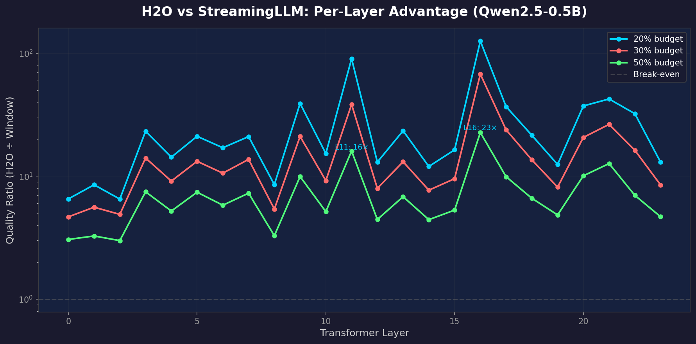

Layers 11, 16, and 21 spike hard. Those are the layers with the most non-local attention patterns. Window eviction just throws away the tokens that matter most.

### This holds across models

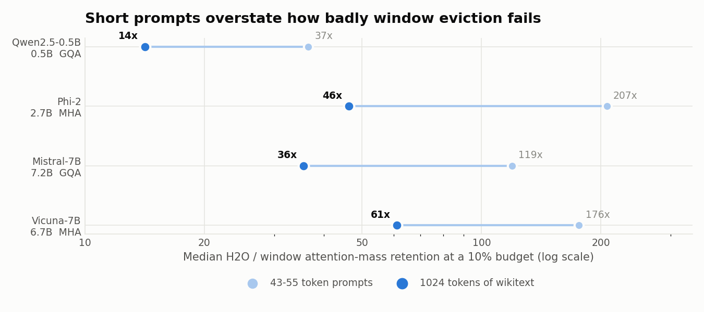

At a 50% KV budget on 1024 tokens: H2O retains 83% of attention mass on Qwen and 91% on Phi-2, while window retains 27% on Qwen and **15% on Phi-2**. At a 10% budget the window numbers fall to 3.9% and 1.7%.

On the original 43-token prompts the same comparison read 87%/94% for H2O and 16%/7% for window. Window looks worse at short lengths than it does at 1024 tokens, which is the opposite of the intuition that long context is where window eviction breaks down. I originally read the cross-model difference as a scale effect; adding a third model at 7B shows that reading was wrong. See [the scale check](#does-the-gap-widen-with-scale-no) below.

**Token confidence is completely task-dependent.** Same model, same threshold: reasoning tasks let you skip 87% of sampling operations, while translation tasks let you skip 0%. This isn't something you can fix with a global threshold.

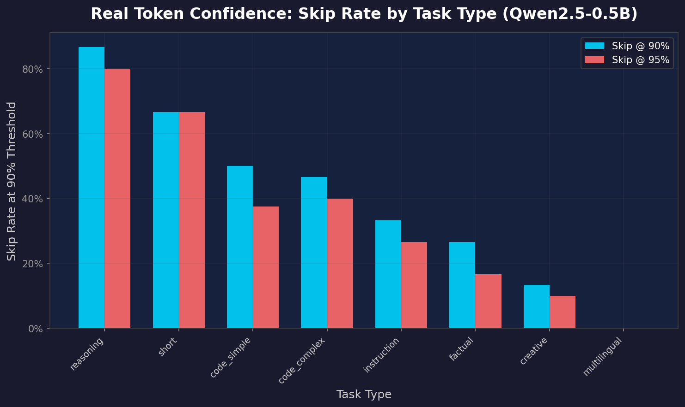

**Stacking is not measured here.** An earlier version of this README said optimizations stack multiplicatively and gave a "sweet spot" of H2O at 50% plus INT4 for 0.86 quality at 2.35x speed. Both are withdrawn. The stacking experiment defines combined quality as the product of the three component scores, so multiplicative composition holds by construction. Its quantization is Gaussian noise added to logits rather than a quantized model, and its speedups are hardcoded formulas. Whether eviction, head pruning and quantization compose on a real model has not been tested here. The script and its charts are kept in the repo as a modelling sketch, not as evidence.

**At 90% cache eviction, window attention is basically dead.** On 1024 tokens, H2O retains 51% of attention mass on Qwen2.5-0.5B and 74% on Phi-2, while window retains 3.9% and 1.7%. If you're doing aggressive KV cache compression on a VRAM-limited GPU, window eviction is not an option. (On the original short prompts the same comparison read 62% against 2%.)

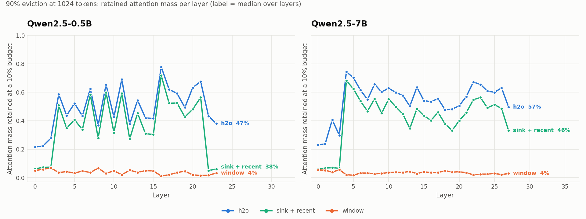

*Per-layer retention at a 10% budget from the 1024-token profiler pass (two windows on the 0.5B, one on the 7B), so its medians differ slightly from the four-window figures in the text. Phi-2 has no per-layer profile at 1024 tokens and is not shown. Reproduce with `python -m src.experiments.visualize_1024`.*

### Does the gap widen with scale? No.

Two models is a direction, not a trend, so this adds a third at 7B and measures all of them twice: on the original short prompts, and on four non-overlapping 1024-token windows of wikitext. Mistral-7B does not fit in 10GB, but the profiler needs one forward pass per input to produce a whole curve, so it runs with weights split across GPU and CPU. Same method throughout: bfloat16, eager attention, single-pass collection.

Median H2O over window retention ratio at a 10% budget:

| Model | Params | Attention | 43-55 token prompts | wikitext 1024 | Change |
|---|---|---|---|---|---|
| Qwen2.5-0.5B | 0.5B | GQA (2 KV) | 36.6x | **14.2x** | -61% |
| Phi-2 | 2.7B | MHA (32 KV) | 206.9x | **46.2x** | -78% |
| Mistral-7B-Instruct-v0.2 | 7.2B | GQA (8 KV) | 119.4x | **35.6x** | -70% |
| Vicuna-7B (llava-1.5-7b tower) | 6.7B | MHA (32 KV) | 176.1x | **61.3x** | -65% |

Spread across the four windows is small next to the differences between models: 13.6x to 14.8x, 43.8x to 51.9x, and 34.1x to 37.7x respectively. The comparison is stable; the length effect is not noise.

Two things come out of this.

**The short-prompt numbers were inflated across the board**, by 2.6x to 4.5x. Every cross-model ratio previously reported here was measured at 43 to 55 tokens. KV eviction is a long-context technique and there is nothing to evict at 43 tokens, so those figures described a regime nobody operates in.

**It is attention architecture, and the matched-scale pair proves it.** Vicuna-7B, reached through the llava-1.5-7b checkpoint whose text tower is exactly it, is a multi-head model at the same scale as Mistral-7B. That pair isolates attention design from size:

| | ~7B GQA | ~7B MHA |
|---|---|---|
| Mistral-7B-Instruct-v0.2 | 35.6x | |
| Vicuna-7B | | **61.3x** |

A factor of **1.72x** between two models of the same size that differ in attention design. Across all four models both MHA checkpoints (46.2x, 61.3x) sit above both GQA checkpoints (14.2x, 35.6x), and Vicuna is the highest of the four despite Phi-2 being the model that originally suggested the pattern, so this is not a quirk of Phi-2.

That also means parameter count does not order this list: 2.7B Phi-2 sits above 7.2B Mistral because one is MHA and the other is GQA.

Splitting the ratio at 1024 tokens shows where each model sits:

| Model | H2O retention at 10% | Window retention at 10% | Mean H2O knee |
|---|---|---|---|
| Qwen2.5-0.5B | 0.510 | 0.0382 | 0.159 |
| Phi-2 | 0.744 | 0.0159 | 0.057 |
| Mistral-7B-Instruct-v0.2 | 0.727 | 0.0203 | 0.060 |

Qwen2.5-0.5B is the outlier at the low end and the reason is that H2O does worse on it, not that window does better. Phi-2 and Mistral land in nearly the same place on every column despite a 2.7x parameter difference.

The knee is not monotone in parameters either. It is 0.159 on the 0.5B model and about 0.06 on both larger ones, which reads as a small-model versus larger-model distinction rather than a smooth trend. An earlier version of this README reported the knee falling steadily with size (0.122, 0.076, 0.055); that was measured on short prompts and does not hold at a controlled length.

So the durable claim is: **on real attention at a realistic context length, window eviction loses 14x to 61x more attention mass than H2O at a 10% budget, on every model tested.** Attributing the spread to scale is not supported. Attributing it to attention architecture is supported by a matched-scale pair and by both MHA models ranking above both GQA models.

Reproduce with `python -m src.experiments.exp_scale_validation`.

### Ranking what actually moves this: architecture, length, then scale

The cross-model comparison above mixes architectures, so it cannot separate scale from anything else. Qwen2.5 ships base checkpoints from 0.5B to 7B with one tokenizer, one attention design and one training recipe, which makes a clean test possible: every model sees a byte-identical token sequence, so length is controlled exactly rather than approximately.

Median H2O over window ratio at a 10% budget:

| Model | Params | Layers | 43-token prompts | wikitext 512 | wikitext 1024 |
|---|---|---|---|---|---|
| Qwen2.5-0.5B | 0.5B | 24 | 36.6x | 14.8x | **13.6x** |
| Qwen2.5-1.5B | 1.5B | 28 | 46.2x | 14.5x | **14.5x** |
| Qwen2.5-3B | 3.1B | 36 | 50.7x | 15.7x | **15.6x** |
| Qwen2.5-7B | 7.6B | 28 | 53.6x | 17.4x | **16.6x** |
| Qwen2.5-Coder-1.5B | 1.5B | 28 | 47.5x | 14.5x | **14.5x** |

**Within one family the ratio does rise with scale, monotonically.** 13.6x to 16.6x from 0.5B to 7.6B. The original intuition was directionally right.

**The effect is small.** Fifteen times the parameters buys 22%. Put the three effects side by side, all measured at a 10% budget:

| Effect | Comparison | Size |
|---|---|---|
| Context length | Qwen2.5-0.5B, 43-token prompts 36.6x vs 1024 tokens 13.6x | **2.69x** |
| Attention architecture | Mistral-7B GQA 35.6x vs Vicuna-7B MHA 61.3x, matched scale | **1.72x** |
| Model scale | Qwen2.5 0.5B 13.6x vs 7.6B 16.6x, in-family at 1024 tokens | **1.22x** |

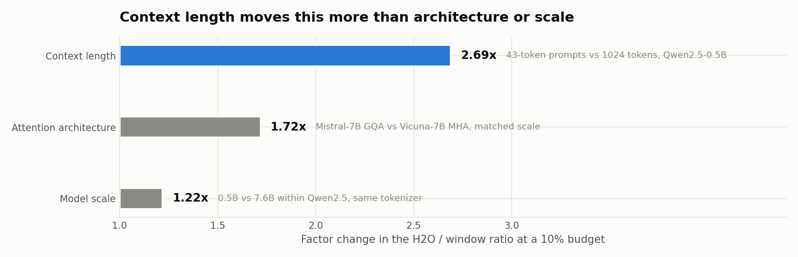

An earlier version of this table put architecture first at 3.25x. That figure came from comparing Qwen2.5-0.5B against Phi-2, which differ by 5x in parameters as well as in attention design, so it charged the scale difference to architecture. With a matched-scale pair the architecture effect is 1.72x and **context length is the largest of the three**.

Scale remains the weakest by a wide margin. The original cross-model numbers looked like a scale effect because they varied architecture and input length at once, and both move the measurement more than size does.

**Training data contributes nothing measurable.** Qwen2.5-Coder-1.5B is the same size and architecture as Qwen2.5-1.5B on a code-heavy mix, and the two land at 14.48x and 14.54x, a 0.4% difference. Whatever varies across this family is size, not what the models were trained on.

Both halves of the ratio move, and both move slightly:

| Model | H2O retention at 10% | Window retention at 10% | Mean H2O knee |
|---|---|---|---|
| Qwen2.5-0.5B | 0.510 | 0.0386 | 0.157 |
| Qwen2.5-1.5B | 0.551 | 0.0364 | 0.158 |
| Qwen2.5-3B | 0.554 | 0.0358 | 0.134 |
| Qwen2.5-7B | 0.574 | 0.0353 | 0.134 |

The knee is not a smooth trend even here. It sits at about 0.157 for the two smaller models and 0.134 for the two larger ones, which is a step rather than a slope, and the 3B is the deepest model in the family at 36 layers so depth and size do not move together.

So the practical summary: if you are choosing a KV eviction policy, the input length you are serving and the attention design of your model tell you far more than the parameter count does. Reproduce with `python -m src.experiments.exp_family_scaling`.

### End-to-end validation: does the proxy predict real output quality?

Attention-mass retention is useful as a diagnostic: it explains *why* window eviction fails. But it doesn't directly tell you what happens to the model's output. So I ran fixed-target logprob replay and greedy generation similarity at 1024 tokens across budget fractions (0.1, 0.2, 0.3, 0.5, 0.75, 0.9), with window, H2O and hybrid plus two dynamic policies: **SnapKV** and **Step-by-Step Entropy-guided KV Pruning (SDE-KV / adaptive)**.

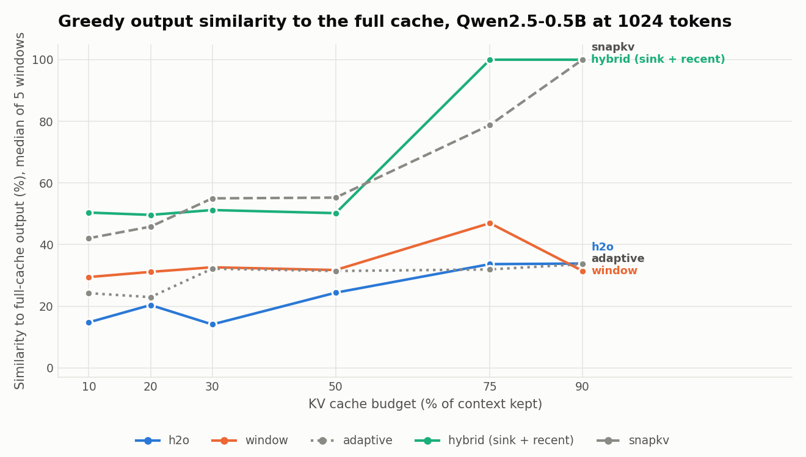

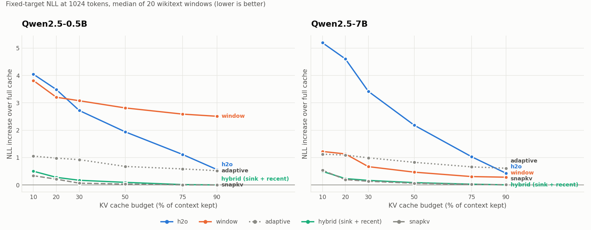

*Both charts are medians over five 1024-token wikitext windows. Greedy similarity is for the 0.5B only; the 7B was scored on NLL. The full tables are in [the proxy audit](#does-the-proxy-predict-quality-within-a-policy-yes-across-policies-it-inverts).*

Key findings from E2E validation:
- **The `snapkv` scorer and hybrid** are the two best policies at both scales. (`snapkv` here is a simplified selector that ranks keys by the variance across heads of the last 16 queries' attention. It is not the published SnapKV, which sums observation-window attention and pools it, so these results do not speak for SnapKV itself.) On the 7B, `snapkv` adds 0.10 nats at a 10% budget against 0.65 for hybrid; on the 0.5B the two are within 0.1 of each other at every budget. Both reproduce the full-cache greedy output exactly at a 90% budget on the 0.5B.
- **SDE-KV (adaptive)** sits in the middle at both scales and flattens early: on the 7B it still adds 0.73 nats at a 90% budget. Its step-by-step budget expansion avoids the worst failures but does not close the gap to the sink-based policies.
- **H2O and window** are the two worst. Which of them is worse depends on the model: window on the 0.5B, H2O on the 7B, where H2O adds 5.9 nats at a 10% budget.

**Prior art.** These policies are not new as of 2026. Layer and head budget allocation is covered by [LAVa](https://arxiv.org/abs/2509.09754), [ZigZagKV](https://arxiv.org/abs/2412.09036), [CAKE](https://arxiv.org/abs/2503.12491) and [Ada-KV](https://arxiv.org/abs/2407.11550). Decode-time entropy-guided allocation is covered by [InfoKV](https://arxiv.org/abs/2606.26875), [ReasonAlloc](https://arxiv.org/abs/2606.11164) and [Moment-KV](https://arxiv.org/abs/2605.29873). Rate-distortion budget allocation is covered by [RDKV](https://arxiv.org/abs/2605.08317) and [RateQuant](https://arxiv.org/abs/2605.06675). SDE-KV has not been benchmarked head-to-head against any of them, so treat it here as a reimplementation used as a probe, not as a competitive policy. What this repo contributes is the cross-scale measurement and the proxy-versus-end-to-end audit, not the policies.

### Does the proxy predict quality? Within a policy, yes. Across policies, it inverts.

Everything above measures attention-mass retention, which is a proxy. This is the audit. Five policies across six budgets, five 1024-token wikitext windows, scored two ways: fixed-target logprob replay (NLL of the full-cache greedy targets under a pruned cache) and greedy text similarity. The short-prompt condition uses the same grid on the default five prompts, so both lengths have n=5.

NLL under a pruned cache at 1024 tokens, lower is better:

| Policy | 10% | 20% | 30% | 50% | 75% | 90% |
|---|---|---|---|---|---|---|
| hybrid (sink+recent+H2O) | **1.48** | **1.49** | **1.30** | **1.22** | 1.23 | 1.23 |
| snapkv | 1.65 | 1.49 | 1.34 | 1.22 | 1.25 | 1.24 |
| adaptive | 1.86 | 1.84 | 1.73 | 1.69 | 1.63 | 1.63 |
| h2o | 4.94 | 4.41 | 4.13 | 2.89 | 2.49 | 1.81 |
| window | 5.24 | 5.65 | 5.55 | 4.54 | 4.35 | 4.53 |

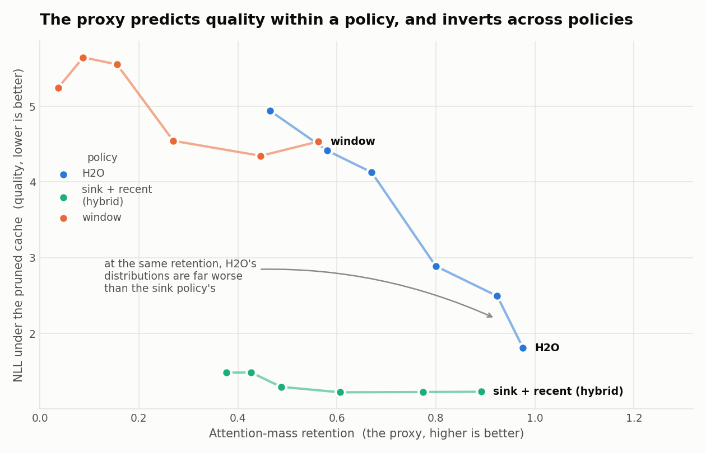

Now put that next to what the proxy says. At every budget the proxy ranks the policies **h2o > sink > window** by retained attention mass, without exception. That ordering is true by construction: H2O keeps the keys with the most mass, so no other keep set of the same size can retain more. It is not a finding about the proxy. What the audit measures is that the policy that maximises the proxy is far worse in quality than the sink-based policies (and worst of all five on the 7B), so maximising retained mass is not the same as preserving output quality. On NLL the order is **hybrid and snapkv first, h2o a distant fourth, window last**.

| Budget | proxy: h2o | proxy: sink | quality: h2o NLL | quality: hybrid NLL |
|---|---|---|---|---|
| 10% | 0.465 | 0.377 | 4.94 | 1.48 |
| 50% | 0.800 | 0.606 | 2.89 | 1.22 |
| 90% | 0.976 | 0.891 | 1.81 | 1.23 |

H2O retains more attention mass than the sink-based policies at every budget and produces distributions two to three times worse. Even at a 90% budget it has not caught up with what hybrid achieves at 10%.

**The proxy is not useless, and the failure is specific.** Within the policies it can score exactly, retention predicts NLL strongly: r = -0.91 at 1024 tokens and -0.80 on short prompts, pooled across h2o and window over six budgets (see the 7B paragraph below for why the per-policy figures are the safer ones), each scored against retention computed on its own condition's prompts. Sweep a budget for a fixed policy and the proxy tells you what will happen. Compare two policies and it can tell you the opposite of the truth.

**The inversion is not a long-context artifact.** With retention recomputed on each condition's own prompts, the proxy orders the policies h2o > sink > window at every budget at *both* lengths, while NLL puts the sink-based policy first at every budget at both lengths. Six budgets, two lengths, twelve opportunities to agree, zero agreements. Because H2O always tops the proxy, this count can only fail through H2O, so read it as a statement about H2O and the sink policy, not as a test of many policies. This is a property of what the metric measures, not of the regime it is measured in.

Length does change how good a within-policy predictor it is: r improves from -0.80 at short prompts to -0.91 at 1024 tokens. Short prompts also flatter the proxy in absolute terms, with h2o reading 0.635 at a 10% budget on the short set against 0.515 at 1024 tokens, which is the same short-prompt inflation seen throughout this repo.

**At 7B the inversion holds and the pooled figure does not.** The same grid on Qwen2.5-7B (five 1024-token windows, bf16, retention recomputed on the same windows) gives a median NLL increase averaged over budgets of 0.04 for snapkv, 0.19 for hybrid, 0.94 for adaptive, 1.19 for window and 3.31 for h2o. The proxy still ranks h2o > sink > window at every budget, so its best policy is the NLL-best policy at 0 of 6 budgets, as on the 0.5B. What changes is that h2o is now worse than window, not better. Correlated one policy at a time over the six budgets, retention still predicts NLL (r = -0.995 for h2o, -0.85 for window, -0.77 for hybrid on the 7B; -0.99, -0.72 and -0.71 on the 0.5B). Pooled across h2o and window, the -0.91 above becomes -0.88 when recomputed with the 7B audit script on the 0.5B and +0.30 on the 7B. The -0.91 mixes two policies, so it was partly a cross-policy number, and cross-policy is exactly where the proxy fails. Read "within a policy" strictly: one policy, swept over budget. Results are in `reports/experiments/e2e_kv_logprob_qwen2.5_7b_long1024_w*` and `reports/experiments/proxy_audit_7b_vs_0.5b_20261021.txt`.

**A third model, a second family: Mistral-7B-Instruct-v0.2, 20 windows.** The same grid on Mistral-7B-Instruct-v0.2 (grouped-query attention, an instruction-tuned checkpoint, bf16 with CPU offload, twenty independent 1024-token wikitext windows) gives the same picture. Mean NLL increase over the six budgets, with a 95% bootstrap interval over windows: `snapkv` scorer 0.08 [0.02, 0.17], hybrid 0.09 [0.06, 0.16], adaptive 0.83 [0.70, 0.99], window 1.66 [1.28, 2.16], h2o 2.47 [2.27, 2.62]. H2O is worst of the five at every budget, as on the Qwen 7B. The proxy still ranks h2o > sink > window at every budget, so its top policy is never the NLL-best one (0 of 6). Within one policy over budget, retention still predicts NLL: r = -0.997 for h2o, -0.88 for window and -0.80 for hybrid. Pooled across the three policies the proxy can score, r = -0.17 [-0.34, -0.03], and across h2o and window only it is +0.11 [-0.14, +0.28]: the interval includes zero, so the pooled figure carries no usable signal across policies. These intervals resample windows only. The 0.5B and Qwen 7B figures above use five windows and have no interval. As noted above, the "0 of 6" count can only fail through H2O. Protecting the sink does not rescue H2O. The `sink_h2o` variant, which pins the first four positions and fills the rest by mass, scores 2.465 [2.27, 2.63] on Mistral and 3.313 [2.91, 3.76] on the Qwen 7B, against 2.466 and 3.313 for plain H2O. The paired difference is +0.001 [-0.017, +0.011] on Mistral and +0.000 [-0.002, +0.027] on Qwen, and the per-budget values match to three decimals. The first positions are already among the highest-mass keys, so pinning them keeps the same set. What hybrid adds over H2O is the recent window, and the gap is large: hybrid beats `sink_h2o` by 2.4 nats on Mistral [2.16, 2.55] and 3.1 on Qwen [2.84, 3.69]. Whether other H2O implementations behave the same is not tested here. Results: `reports/experiments/e2e_kv_logprob_mistral_7b_instruct_v0.2_long1024_w*` `reports/experiments/proxy_audit_mistral_7b_20261029.txt` and `reports/experiments/sink_h2o_check_20261029.txt`.

**Why the proxy ranks the policies wrongly: a hindsight test.** The proxy counts the mass the prompt's own queries put on each key. The replay instead asks how well the next tokens decode, and those tokens' queries are not in that mass. `exp_hindsight_retention.py` re-scores the same keep sets (the ones the replay builds at its first prune, from its own selection code) under four masses taken from one full-cache pass over the prompt plus the logged target tokens: the proxy's prompt-query mass; hindsight mass, the attention the decode queries put on each prompt key; the prompt-query mass divided by the number of queries that can see each key, as a control; and hindsight split into two halves, as a noise floor. It correlates each retention with the measured NLL increase over the 18 policy-budget cells (h2o, window, hybrid; six budgets) by Kendall tau-b, with a bootstrap over windows.

| Model (windows) | Prompt-query mass (the proxy) | Hindsight mass | Causal-normalized control |
|---|---|---|---|
| Qwen2.5-0.5B (5) | -0.58 [-0.67, -0.29] | -0.77 [-0.84, -0.48] | -0.39 [-0.60, -0.07] |
| Qwen2.5-7B (5) | -0.31 [-0.36, -0.22] | -0.49 [-0.53, -0.40] | -0.73 [-0.82, -0.62] |
| Mistral-7B-Instruct (20) | -0.43 [-0.48, -0.39] | -0.57 [-0.62, -0.53] | -0.74 [-0.80, -0.70] |

(Negative means retention predicts quality; intervals resample windows only.) At every budget on all three models, the policy that retains the most prompt-query mass is not the best on NLL (0 of 6), while the policy that retains the most hindsight mass is (6 of 6). Hindsight retention is stable (split-half tau +0.91 to +0.96) and improves the correlation on both 7B models, but not clearly on the 0.5B. The control matters most: dividing the mass by how many queries can see each key gets the best policy right at every budget and beats hindsight on both 7B models. So most of the failure is the well-known bias of cumulative attention toward early keys, which more queries have seen, and not a lack of foresight. This confirms an existing effect on these models and does not identify a new mechanism. Two limits: the keep sets are the first prune only, and the three scorable policies are not a large sample of policies.

**A correction to the pooled correlations above.** The audit scored hybrid on the sink-plus-recent retention curve, which is not hybrid's keep set: hybrid also fills with top-mass keys. Scored on its real keep set, hybrid retains almost as much prompt-query mass as H2O (0.46 against 0.50 at a 10% budget on the 0.5B), not the 0.39 used earlier. The pooled Pearson figures that included hybrid (for example -0.17 on Mistral) were therefore mis-specified. The h2o-plus-window figures stand, because those two curves are exact. With true keep sets, the proxy's rank correlation with quality over all three policies is moderate (tau -0.31 to -0.58), not absent. What the proxy reliably gets wrong is which policy to prefer: its top policy is never the best.

One reason, supported by the hindsight test above, is that attention mass from the prompt's own queries is not the mass the next tokens use. Sink-based policies keep the recent positions the next tokens attend to; H2O keeps the positions that accumulated the most attention over the whole prompt. Those sets differ, and the gap is invisible to a metric that only sums prompt-query mass.

Greedy similarity at the same budgets agrees on the ranking, with hybrid and snapkv reaching 1.00 (exact reproduction of the full-cache output) at high budgets while h2o plateaus at 0.34. It is the noisier of the two metrics and should not be used alone: h2o and window stay non-monotone in budget even at n=5, because once a greedy continuation diverges early its similarity score is close to arbitrary.

**Length changes the shape too.** At short prompts hybrid improves steadily with budget, 3.42 to 0.46. At 1024 tokens it starts far better and then flattens, 1.48 to 1.23. Sink-based policies degrade gracefully at long context and stop improving early; H2O needs a large budget before it becomes tolerable at either length.

The retention values in the tables above come from the 1024-token profile and are the matched proxy for the long rows. The cross-length statements in this section use a separate pass that recomputes retention on each condition's own prompts, aggregated the same way the NLL cells are (median across layers per prompt, then median across prompts), so the two sides of each correlation are measured on the same inputs.

Reproduce with `python -m src.experiments.exp_e2e_kv_cache` variants, or see `reports/experiments/e2e_kv_logprob_qwen2.5_0.5b_20260916_213111.json`.

### Why the proxy question matters

Two 2026 results make the gap between the proxy and real quality concrete:

- [The Pitfalls of KV Cache Compression](https://arxiv.org/abs/2510.00231) shows compression makes models silently drop individual instructions in multi-instruction prompts, across StreamingLLM, SnapKV, TOVA, H2O and K-Norm. Aggregate quality scores miss this.
- [Transactional Attention](https://arxiv.org/abs/2604.11288) states the structural version: credentials, API keys and config values carry near-zero attention for most of a generation and are essential at the moment they are needed. No policy scored on realized attention retains them reliably.

Attention-mass retention is the proxy both failures route through, which is why this repo measures where it holds and where it breaks instead of proposing another policy.

For deeper mathematical details, see the [Technical Report](TECHNICAL_REPORT.md).

## All experiments

| Experiment | Trials | What I measured | What stood out |
|---|---|---|---|
| KV Cache Eviction | 72 | 6 policies (H2O, Window, a variance-based `snapkv` scorer, etc.) | H2O wins on attention-mass proxy |
| Token Confidence | 300 | Skip rates at thresholds | 70% skip rate at temp=0.3 |
| Head Pruning | 39 | Progressive head removal | Cliff at 5%, then plateau to 80% |
| Quantization Sensitivity | 216 | Simulated per-layer noise on synthetic weights | Pattern is built into the generator, not measured (see below) |
| Self-Speculative Decoding | 62 | Early exit layer selection | 50% exit → 2× speedup |
| PCIe Transfer | 36 | Pinned vs paged bandwidth | 24.4 vs 9.5 GB/s |
| Reasoning Token Waste | 480 | CoT tokens removed | 80% removable for easy tasks |
| Real Model Analysis (0.5B) | 976 | All above on Qwen2.5-0.5B | Where synthetic fails |
| Real Model Analysis (2.7B) | 1,296 | Same on Phi-2 | H2O gap gets worse on bigger models |
| Optimization Stacking | 108 | Modelled combinations of KV, pruning and noise-simulated quantization | Withdrawn: composition and speed are defined by formula, not measured |
| Speculative Routing (SEER) | 22 | Live-trajectory early exit | Signal predicts quality (AUC 0.92), but saves nothing here |
| Entropy → Quality | 20 | Does low entropy mean correct answer? | Confident and wrong is common |
| Difficulty Label Validation | 66 | Are the easy/hard labels real? | They encode prompt length, not difficulty |
| Profiler Validation | 60 | Single-pass curves vs the grid sweep | Exact match, cost flat in curve resolution |
| Profiler Memory | 12 | Incremental mass accumulation | 21.5x less peak memory, still exact |
| Long-Context Sampling | 36 | Sampling error on real 1k-4k attention | Query sampling works, key sampling does not |
| Scale Validation | 21 | 0.5B vs 2.7B vs 7B, same method | Gap is not monotone in parameters |
| Family Scaling | 85 | Qwen2.5 0.5B-7B at fixed token length | Scale is real but the weakest of three effects |
| E2E KV Cache (greedy) | 105 | Greedy generation under dynamic caches | `snapkv` scorer and adaptive maintain similarity |
| E2E KV Cache (logprob) | 105 | Distribution distortion under dynamic caches | Adaptive budget prevents perplexity spikes |
| E2E at 1024 tokens | 620 | Proxy vs quality, matched n=5 both lengths | Proxy inverts the policy ranking |
| Block Expiry | 330 | vLLM RFC 39076's decode-time expiry rule, 2K to 32K | Cheap on ordinary text, unsafe for dormant content in some windows |

## What didn't work

### Speculative Early-Exit Routing (SEER): original claim withdrawn, rerun changes the story

The original claim was that SEER retained 100% of the large model's quality while running easy prompts locally. That claim was wrong. The run behind it (`prompt_routing_20260701_005556.json`) was invalid three ways:

- Both models ran in fp16. Phi-2 produced non-finite logits, so `argmax` returned token 0 and both models emitted `!!!!!!!!!!!!!!!!!!!!` on all 22 prompts.
- The quality metric was tautological. On abort the code set `routed_text = large_text`, then scored the two against each other. That is 1.0 by construction, so every aborted trial reported perfect quality while measuring nothing.
- Policy and measurement were fused. Generation stopped at step K when the thresholds fired, so the small model's real output was never observed on the prompts it would have been judged on.

The experiment was rewritten to load both models in bfloat16 with a finite-logit guard, generate every prompt to completion on both models, and apply the routing rule afterwards. Rerun: `prompt_routing_20260916_133528.json`.

**The thresholds could never have fired.** SEER required mean top-probability over the first 3 tokens to reach 0.85. The highest value observed on any of the 22 prompts is 0.829. Zero prompts satisfy both conditions. The 100% escalation rate was fixed by the thresholds, not discovered from the data.

**The signal itself works, which is the part worth keeping.** Mean top-probability over the first K=3 tokens separates prompts the small model handles well from ones it does not, at AUC 0.92 (95% CI 0.77 to 1.00, bootstrap, n=22, median split). The same statistic averaged over the full 20-token generation gets AUC 0.65 (CI 0.40 to 0.88). The predictive content is concentrated in the first few tokens and gets diluted by longer averaging. This is a real difference from the static-prefill result below, which found no separation at all.

**It still saves nothing on this hardware.** Measured cost is 45.0 ms/token for Qwen2.5-0.5B against 53.3 ms/token for Phi-2, a ratio of 0.844 for models 5.4x apart in parameters. Decode at this size is bound by per-step overhead, not model compute. At that ratio the best operating point holding mean quality at or above 0.80 saves -0.4%, which is to say it costs slightly more than always calling the large model.

**Batching does not rescue it; it makes it worse.** An earlier version of this section projected 44% savings under batched serving from an assumed cost ratio. Measured instead (`exp_routing_cost.py`, SDPA attention, bf16, Hugging Face `generate` with the KV cache, 20 tokens), at the same operating point (escalate below 0.55, keep 9 of 22 prompts local):

| Batch | Qwen2.5-0.5B ms/token | Phi-2 ms/token | Cost ratio | Savings |
|---|---|---|---|---|
| 1 | 40.0 | 47.3 | 0.845 | -0.5% |
| 4 | 10.1 | 11.6 | 0.872 | -2.1% |
| 16 | 2.64 | 2.78 | 0.951 | -6.7% |
| 32 | 1.47 | 1.43 | 1.030 | -11.4% |

Times are per sequence-token, so batching cuts both models' cost by about 30 times, but it cuts the larger model's slightly more, and at batch 32 the 0.5B is no cheaper than Phi-2. Both models are far too small to be compute-bound on this card: each decode step costs roughly the same whatever the model does, so a small model buys nothing and every escalation pays for the first K tokens twice. The 38% figure at the parameter ratio assumes cost scales with parameters, which it does not here. Routing between models this small does not save cost on this hardware at any batch size measured. Whether it does for larger, compute-bound pairs or under a serving engine is not tested here.

**A separate problem surfaced.** The hand-assigned difficulty labels do not track what the small model can actually do. Measured small-model quality is 0.42 on prompts labelled hard, 0.35 on easy, and 0.26 on medium. The ordering is not monotone and the labels are close to uninformative, which undermines the ground truth used in the static-routing experiment below as well.

Caveats: 22 prompts, one model pair, median split. Quality is measured as similarity to the large model's greedy output, which is agreement and not correctness. The invalid July file is kept in `reports/experiments/` as the evidence for this correction and should not be used for anything else.

### Static prefill features don't predict difficulty, and the labels were wrong too

The original routing experiment measured 18 static prefill features (first-token entropy, attention sparsity, sink mass and others) against hand-written easy/medium/hard labels, and reported that the signals overlapped. That negative result held up, but for a different reason than assumed. Checking it required first checking the labels.

Three measured difficulty signals were computed for the same 22 prompts: one minus similarity between the small and large model's greedy output, the small model's NLL on the large model's actual output (teacher-forced, so it does not depend on string matching), and the fraction of the large model's tokens the small model would not have chosen.

**The three measured signals agree with each other. The hand labels agree with none of them.**

| | vs hand label | vs 1 - similarity | vs NLL |
|---|---|---|---|
| 1 - similarity | -0.111 | | |
| NLL(large under small) | -0.138 | +0.391 | |
| top-1 disagreement | -0.198 | +0.444 | +0.875 |

Spearman, n=20. The hand labels are slightly negatively correlated with every measurement of what the small model can actually do.

**What the labels do encode is prompt length.** Against the hand labels, `output_len` scores +0.887 and `input_token_count` +0.749. Harder-sounding tasks were written as longer prompts.

**That confound explains the three attention features that looked predictive.** Five static features clear a Bonferroni threshold against the hand labels: `output_len` (+0.89), `input_token_count` (+0.75), `avg_attention_sparsity` (-0.74), `avg_attention_entropy` (+0.71) and `max_sink_mass` (-0.68). Attention entropy, sparsity and sink mass are all mechanically determined by sequence length. They were tracking how long the prompt was.

**Against measured difficulty, the static features find nothing.** Zero of 18 clear the Bonferroni threshold against NLL, and zero of 18 against similarity. The trajectory features do clear it: mean top-probability over the first K=3 generated tokens scores -0.638 (p=0.0004) against similarity and -0.570 (p=0.0033) against NLL.

So the original negative result survives and gets stronger. It was not an artifact of bad labels. If anything the bad labels flattered the static features, because length correlates with the labels and with several of the features. You have to start generating before the model tells you anything useful about the prompt.

One practical consequence: the difficulty ordering is not the intuitive one. `code_hard` and `multi_step` sit in the low-difficulty group for a 0.5B base model, while `simple_math` and `classify` sit in the high-difficulty group. Fluent continuation is easy and arithmetic is hard, which is close to the opposite of how the prompts were labelled.

Caveats: n=20 after dropping two prompts where the large model produced no scorable output, one model pair, and the tercile group means are noisy at this sample size. The correlations are the result; the group means are illustrative. Reproduce with `python -m src.experiments.exp_difficulty_validation`.

### Entropy doesn't predict whether the answer is correct
Tested 14 factual prompts with verifiable answers. The model is often *more confident when it's wrong* than when it's right. If you're building a quality gate based on entropy, don't, at least not on small models. This is a real trap.

## Single-pass retention curves

The experiments above compute retention by building a keep-mask at one budget, summing the attention that lands on the kept keys, then repeating for every budget in a grid. That is one pass over the attention tensor per budget point, and it only tells you about the budgets you picked in advance.

Storage and computer architecture solved this shape of problem decades ago. Mattson's stack algorithm computes a full miss-ratio curve across every cache size in one pass, because the per-reference quantity it needs does not depend on the cache size you are asking about. The same reduction works here.

For a layer's attention `A` with shape `[heads, queries, keys]`, define the per-key mass `mass[k] = A[:, :, k].sum()`. Every policy in the sweep scores as a sum of mass over its keep set, so:

- **H2O** keeps the top-b keys by cumulative attention, which is exactly the top-b by mass. Its curve over all budgets is the normalized cumulative sum of mass sorted descending, which is the Lorenz curve of the mass distribution.
- **Window** keeps the last b keys, so its curve is the normalized suffix sum.
- **Sink plus recent** keeps a prefix and a suffix, so prefix and suffix sums give it in constant time per budget.

One reduction from `[heads, queries, keys]` to `[keys]` therefore yields the exact curve at every integer budget for all three policies.

### It reproduces the grid sweep exactly

Both paths run against the same extracted attention from Qwen2.5-0.5B in the same process. Maximum absolute difference across 24 layers, 8 prompts and 5 budget fractions:

| Policy | Max abs error vs grid sweep |
|---|---|
| H2O | 1.97e-07 |
| Window | 5.50e-08 |
| Sink + recent | 2.13e-07 |

That is float64 rounding. The curve is not an approximation of the sweep, it is the same quantity computed once instead of five times.

### The cost does not depend on how much of the curve you want

This is the property that matters. The grid is linear in the number of budget points; the single pass is flat, because it never asks about a specific budget. Synthetic attention, 16 heads, sequence length 1024:

| Budget points | Grid sweep | Single pass | Speedup |
|---|---|---|---|
| 5 | 181 ms | 40 ms | 4.6x |
| 10 | 318 ms | 35 ms | 9.1x |
| 20 | 657 ms | 35 ms | 18.8x |
| 50 | 1549 ms | 34 ms | 46.0x |

So the useful comparison is not 5 budgets against 5 budgets. It is 5 budgets against all of them. On the real prompts the curve has up to 121 points where the grid has 5, at 1.3x to 3.5x less wall time.

Having the full curve is what makes the knee available. Per-layer H2O knee budgets on these prompts range from 0.02 to 0.99 of sequence length, with a mean near 0.51. A five-point grid cannot resolve that spread, which is the quantity the layer-wise budget allocation literature is trying to estimate.

### Getting the mass without holding the attention

The curve only needs a `[keys]` vector per layer, but the usual way of producing it holds far more. `output_attentions=True` makes the model keep one `[heads, queries, keys]` tensor per layer, so peak memory is `L * H * S^2`. Two changes remove that:

1. **Reduce each layer as it is produced.** Nothing needs all layers at once, so the attention module's output is reduced to `[keys]` and dropped there. Peak becomes `H * S^2`.
2. **Feed the prompt in chunks.** Causal attention means the prompt can be prefilled in chunks of `C` against a KV cache, which is what a real serving stack does anyway. Each chunk contributes the query rows it computed, and the contributions sum. Peak becomes `H * C * S`.

Measured on Qwen2.5-0.5B, float32 attention, against the mass computed the incumbent way:

| Sequence length | Reference (all layers held) | Reduce per layer | Chunked, C=64 |
|---|---|---|---|
| 256 | 239 MB | 130 MB (1.8x) | 82 MB (2.9x) |
| 512 | 717 MB | 299 MB (2.4x) | 88 MB (8.1x) |
| 1024 | 2152 MB | 598 MB (3.6x) | 100 MB (21.5x) |

The saving grows with sequence length because the `S^2` term is what is being removed. Reducing per layer is exact (max abs error 0.0). Chunking is accurate to 2.3e-05 relative on mass and 9.3e-07 on the resulting retention curve.

One implementation note, because it cost an hour. Transformers 4.57 captures attention for `output_attentions` by monkey-patching layer forwards, not by hooks, so the capture runs inside the module call and *before* any PyTorch forward hook. A hook cannot stop the tensor being retained. The collector wraps `attn.forward` instead. Under eager attention the module returns its weights whether or not `output_attentions` is set, so the collector never asks for the flag and the model never accumulates anything.

**Chunked accumulation needs float32.** A chunked matmul accumulates the QK product in a different order than a single full-sequence matmul, and bfloat16's 8 mantissa bits shift mass between near-tied keys in a peaked softmax. At sequence length 145, chunking in bfloat16 gives up to 29% relative error on per-key mass against 1.4e-05 in float32. The profiler runs once as calibration, so float32 is the right trade, but this would matter to anyone reusing the collector inside a serving path.

### Sampling: the obvious port of SHARDS is the wrong one

With the collector making long context affordable, the sampling question can be answered on real attention. Wikitext-2 through Qwen2.5-0.5B at 1k, 2k and 4k tokens, float32, three seeds, measured against the exact curve.

There are two places you could sample, and they are not equivalent:

- **Key sampling** subsamples the mass vector, which is the direct port of SHARDS. It saves the sort and the storage of a length-S vector.
- **Query sampling** uses a fraction of query rows. Attention costs `H * S^2` in the queries while the mass vector it produces is only `S` long, so this is the only axis where real work could be saved.

At sequence length 4096, mean absolute error on the H2O curve:

| Rate | Query sampling | Key sampling |
|---|---|---|
| 0.5 | 0.0061 | 0.0544 |
| 0.25 | 0.0144 | 0.1059 |
| 0.1 | 0.0530 | 0.1601 |
| 0.05 | 0.0888 | 0.1847 |

Query sampling at a quarter of the rows gives 0.014 mean error and moves the knee by 2% of sequence length. Key sampling is roughly ten times worse at the same nominal rate, and it cannot save attention work in the first place.

Key sampling fails for a structural reason rather than a sample-size one. Its error barely moves between 1k and 4k tokens (mean signed error +0.053 at rate 0.5 on the 0.5B at both lengths, +0.10 at rate 0.25), so it is bias, not variance. The sign is upward, and the cause is the sampler: the hash sends key 0 to 0, so the attention-sink key is in every sample, and the sink holds a large share of the mass. A sample that always contains the sink retains more mass than the full set does at the same budget fraction. Dropping the sink from the sample flips the error to about -0.12 to -0.15, which is worse, so no choice of sampled keys rescues the curve. An earlier version of this paragraph attributed the bias to subsampling understating extreme order statistics. That explanation was not tested and the sign was wrong.

It does not help that real attention here is less concentrated than the power-law framing suggests. At 4096 tokens the single largest key holds 0.001 of layer 0's mass and it takes 35% of keys to hold half of it. Mass that spread is exactly the regime where subsampling keys distorts the curve.

**What is measured here is fidelity, not speed.** This implementation computes full attention and then selects query rows, so a lower rate does not run faster. At 2048 tokens it takes 1.25s at rate 1.0 and 1.19s at rate 0.1, the selection overhead cancelling the smaller reduction. Realising the saving needs an attention kernel that computes only the sampled rows of `QK^T`. What this experiment establishes is that such a kernel would produce a usable curve at rate 0.25, which is the thing worth knowing before writing one.

### What is not done yet

- **Three policies only.** SnapKV, PyramidKV and the adaptive policy are not expressible as a sum of per-key mass, because they use per-head or per-step structure. They still need the sweep.
- **One family only.** The in-family result covers Qwen2.5. Whether the 22% holds in a family with a different attention design is untested, and the architecture effect above suggests it might not.

Reproduce with `python -m src.experiments.exp_profiler_validation`, `python -m src.experiments.exp_profiler_memory` and `python -m src.experiments.exp_long_context_sampling`.

## Is it safe to free KV blocks that look dead?

vLLM RFC [#39076](https://github.com/vllm-project/vllm/issues/39076) proposed freeing KV blocks from a running request once their attention mass stays low during decode. It projected a 30 to 60 percent smaller active KV cache at 32K to 128K contexts and reported no measurements. The RFC was closed as not planned, but the question applies to any decode-time block-expiry scheme, so this measures the premise.

**Method.** The RFC's rule at its defaults: blocks of 16 tokens, mass read every 32 steps, smoothed with an EMA of 0.9, a block expires after 3 consecutive low reads. It runs on Qwen2.5-0.5B and 1.5B at 2K to 32K tokens of wikitext, using exact softmax weights. Expired blocks are masked out of attention, so the quality effect is real and no memory is freed. Each run is scored against the full cache on identical teacher-forced inputs, by per-token KL divergence of the next-token distribution. Two controls free the same number of blocks without looking at attention: a recent window after the sink block, and random blocks that spare the sink. Uniform random expiry is not used, because it removes the attention-sink block about half the time and says nothing about mass. A threshold of zero gives the noise floor, which was exactly 0 in all 31 windows in both fp32 and bf16.

The RFC sums mass over heads but does not say whether layers are also summed, which changes the threshold by a factor of up to heads times layers. Results are given for each reading, and also relative to the uniform share 1/blocks, because a fixed absolute threshold means very different things at 2K and 32K.

### Attention mass is concentrated, more so at long context

Share of a request's blocks that hold 90% of the layer-pooled attention mass, Qwen2.5-0.5B, five windows per length:

| Context | 2K | 4K | 8K | 16K | 32K |
|---|---|---|---|---|---|
| Blocks holding 90% of mass | 39.2% | 21.3% | 25.9% | 20.2% | 21.6% |

The 1.5B gives 27.3% at 8K and 17.4% at 32K (three windows each).

### The projected savings are reachable on ordinary text, under one reading of the threshold

The RFC's threshold of 1e-3, read as a sum over heads only, frees almost nothing up to 8K and 32 to 67 percent at 16K and above, at a small cost on ordinary text:

| Model | Context | Blocks freed | KL vs full cache |
|---|---|---|---|
| 0.5B | 2K | 0% | 0.0000 |
| 0.5B | 4K | 0.1% | 0.0000 |
| 0.5B | 8K | 2.8% | 0.0000 |
| 0.5B | 16K | 31.6% | 0.0015 |
| 0.5B | 32K | 56.3% | 0.0138 |
| 1.5B | 8K | 0.9% | 0.0007 |
| 1.5B | 32K | 67.3% | 0.0084 |

Read as a sum over heads and layers, the same threshold frees at most 0.1% of blocks in any window of either model.

Against rules that ignore attention, on ordinary text (0.5B, KL, lower is better):

| Context | Freed | Mass-gated | Sink + recent window | Random, sink spared |
|---|---|---|---|---|
| 2K | 30% | 0.0211 | 0.0284 | 0.0553 |
| 4K | 30% | 0.0027 | 0.0032 | 0.0928 |
| 8K | 30% | 0.0049 | 0.0102 | 0.0420 |
| 16K | 30% | 0.0015 | 0.0035 | 0.0467 |
| 32K | 30% | 0.0023 | 0.0050 | 0.0369 |
| 2K | 60% | 0.0573 | 0.0996 | 0.1318 |
| 4K | 60% | 0.0159 | 0.0287 | 0.1999 |
| 8K | 60% | 0.0339 | 0.0362 | 0.1211 |
| 16K | 60% | 0.0083 | 0.0114 | 0.1167 |
| 32K | 60% | 0.0154 | 0.0194 | 0.1184 |

The mass signal is about 2.3 to 34 times better than random, depending on length and share freed, but only about 1.1 to 2.3 times better than a plain recent window. With five windows per length it is never worse than that window; with two, it was at 8K and 60% freed, so that earlier reversal was noise.

### But a block that goes quiet and is needed later can be lost

Wikitext articles concatenated together are the best case for expiry, because earlier articles really are irrelevant to later ones. So a second test places a 128-token passage in the context, decodes 160 unrelated tokens, which is long enough for the passage's blocks to be judged dead, and then has the model copy the passage back. The full cache copies it with 89 to 95 percent accuracy, depending on length and model.

At a threshold of 0.1 times the uniform share, which frees 16 to 44 percent of blocks on average (8 to 57 percent in single windows):

| Model | Context | All blocks freed | Passage blocks freed | Copy accuracy (full cache) |
|---|---|---|---|---|
| 0.5B | 2K | 16% | 2% | 0.92 (0.94) |
| 0.5B | 4K | 25% | 2% | 0.89 (0.91) |
| 0.5B | 8K | 42% | 40% | **0.74 (0.90)** |
| 0.5B | 16K | 42% | 0% | 0.92 (0.92) |
| 0.5B | 32K | 37% | 2% | 0.84 (0.89) |
| 1.5B | 8K | 44% | 4% | 0.94 (0.95) |
| 1.5B | 32K | 38% | 0% | 0.94 (0.94) |

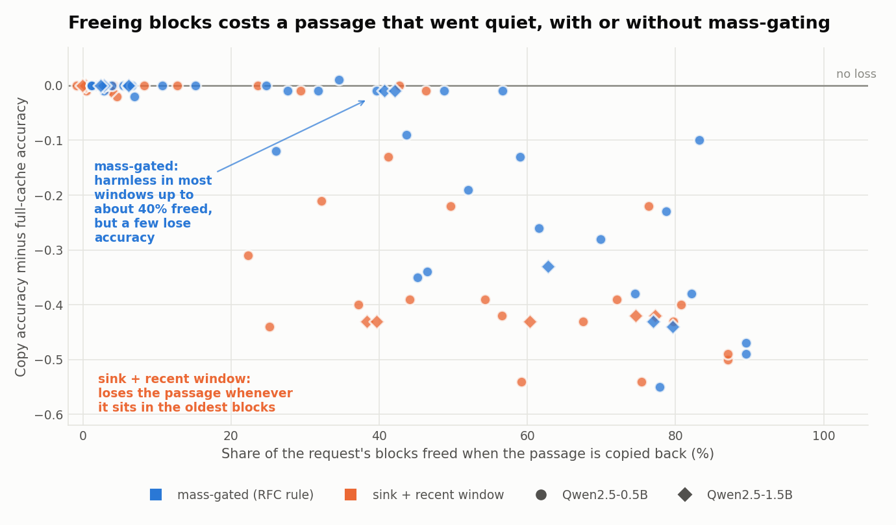

The 0.5B rows are the mean of five windows and the 1.5B rows of three. There is no single safe threshold:

- **Failures at most lengths:** On the 0.5B, 7 of 25 windows lost at least 5 points of copy accuracy at this threshold, at 2K, 4K, 8K and 32K. The worst were two 8K windows, at 0.34 and 0.35, while ordinary-text KL at 8K gave no warning. The 1.5B lost at most 1 point in all 6 of its windows.
- **Same text, other model:** The 1.5B's 8K window uses the same text as the 0.5B's first 8K window, where the 0.5B freed 88% of the passage. The 1.5B freed 12% and kept its accuracy.
- **The RFC's own threshold:** At 32K the head-summed reading frees 53% of blocks on the 0.5B and cuts mean copy accuracy from 0.89 to 0.80; 3 of 5 windows lost 12 to 19 points. On the 1.5B it frees 60% and cuts accuracy from 0.94 to 0.81; 2 of 3 windows lost 7 and 33 points. At 8K and below it frees too little to matter.
- **The recent window:** It loses the passage whenever the passage sits in the oldest blocks, which is its own kind of failure.

### A block-level rule gives up most of the per-layer saving

At the same 0.1 threshold, 31 to 48 percent of blocks are dead when judged on mass pooled across layers at 4K and above, but only 1 to 3 percent are dead in every layer at once. The median layer, judged alone, has 49 to 65 percent dead blocks. A KV block holds every layer of its group, so a block-level rule can only act on the pooled view.

### Limits

- Five windows per length on the 0.5B and three per length on the 1.5B. Per-window results are in `reports/experiments/block_expiry_*`.
- Two small models, both grouped-query attention. No multi-head model here supports a long context.
- One retrieval-style task: copying a 128-token passage. The passage text differs between windows, so passage and length are not separated.
- Contexts up to 32K, not the 128K the RFC discusses.
- Wikitext articles joined together are not one long coherent document.
- Masking is applied but no memory is freed, and mass comes from exact softmax weights, not from a serving kernel.

Reproduce with `python -m src.experiments.exp_block_expiry --lengths 8192:2`, then `python -m src.experiments.analyze_block_expiry`. A 32K window takes about 8 minutes on a 10GB card. Run `python scripts/preflight_resources.py` first, and note that long-context runs need a memory cap, which `exp_block_expiry` applies. Without it, WSL spills the overflow into system memory: 32K prefill took 350 seconds instead of 22, and a window that normally takes 8 minutes had not finished its first stage after 20.

## More charts

### Quantization sensitivity heatmap


**This chart is not a measurement of any real model.** It comes from a synthetic transformer whose weights are random, with outliers planted in every 4th layer by the generator (`i % 4 == 0` in `exp_quantization_sensitivity.py`), and quantization is simulated as noise. The periodic pattern in the heatmap is the pattern the generator was told to produce, so it says nothing about which layers of a real model are sensitive. Per-layer quantization sensitivity of a real model has not been measured here.

### PCIe bandwidth: pinned vs paged


If you're offloading KV cache to CPU RAM, use pinned memory. A 500MB cache offloads in 20ms pinned vs 57ms paged.

## Profiling your own model

The profiler runs a calibration pass and reports what each layer's attention mass looks like as a function of cache budget:

```bash
llm-bench profile --model Qwen/Qwen2.5-0.5B --tokens 1024 --windows 2
llm-bench profile --model /path/to/local/checkpoint --chunk 64   # lower memory
```

Output on Qwen2.5-0.5B, 24 layers in 7.9 seconds:

```
Retention at each budget, median across layers:
  budget         h2o      window        sink
    10%        0.493       0.037       0.406
    30%        0.689       0.161       0.508
    50%        0.810       0.285       0.615

H2O knee, the budget past which extra cache buys little:
  mean 0.145 of sequence, range 0.005 to 0.366
  cheapest layers: L7 (0.005), L16 (0.011), L9 (0.016)
  costliest layers: L2 (0.284), L1 (0.365), L0 (0.366)
```

That spread is the point. On this model the cheapest layer's curve flattens at 0.5% of sequence length while the costliest needs 37%, a factor of 73 between layers in the same model. A uniform budget either starves the expensive layers or wastes cache on the cheap ones.

It writes `reports/profiles/profile_<model>_<timestamp>.json` with, per layer, the full retention curve at 1% budget intervals for H2O, window and sink-plus-recent, the knee, and retention at standard budget fractions. Roughly 160KB for a 24-layer model.

Memory adapts to what is free: the model loads wholly on GPU when it fits, otherwise splits to CPU, and retries with more offload on an OOM. Qwen2.5-7B profiles on a 10GB card in 25 seconds this way. `--chunk` lowers peak memory further without changing the result.

**It emits measurements, not a configuration.** Turning curves into a deployed cache config depends on your serving target, your latency budget and your quality bar, and none of those are visible to a profiling tool. The curves are the input to that decision, not the decision.

## Auto-optimizer

The tool includes a first-pass recommender for optimization stacks:

```bash
python -m llm_bench optimize                        # auto-detect GPU, default 0.5B
python -m llm_bench optimize --params 7 --priority speed   # 7B model, maximize speed
python -m llm_bench optimize --vram 24 --params 13         # simulate a 4090 + 13B model
```

Right now this is a transparent lookup table seeded from the experiments, not a dynamic optimizer that re-reads every JSON file. Its expected-quality and speedup figures are modelled from unmeasured per-technique constants, not measured. Treat it as a sketch of the product direction: it considers VRAM pressure and model size, then cites the benchmark evidence behind each recommendation.

## Setup

```bash
git clone https://github.com/dilbersha/universal-llm-telemetry-suite.git
cd universal-llm-telemetry-suite
pip install -r requirements.txt
python -m llm_bench run        # detects your GPU, downloads a model, runs experiments
python -m llm_bench profile -m Qwen/Qwen2.5-0.5B   # per-layer KV retention curves
python -m llm_bench optimize   # get recommendations for your hardware
python -m llm_bench charts     # generates charts from the data
python -m llm_bench info       # shows your hardware info
```

Or install as a package:
```bash
pip install .
llm-bench optimize
```

The CLI figures out what GPU you have, picks a model that fits your VRAM, and downloads it from HuggingFace. On a 3080 it picks Phi-2 or Qwen2.5-0.5B.

## Data format

Every experiment outputs:
- JSON with full trial configs, metrics, and hardware context
- CSV for pandas / Excel
- Charts in `reports/charts/`

Raw data is in `reports/experiments/`. Feel free to dig through it.

---

## Hardware telemetry (the original project)

This repo also includes the cross-platform inference telemetry suite that started the project. It benchmarks raw throughput, energy efficiency (tokens per joule), and thermal stability.

### M1 Pro vs RTX 3080

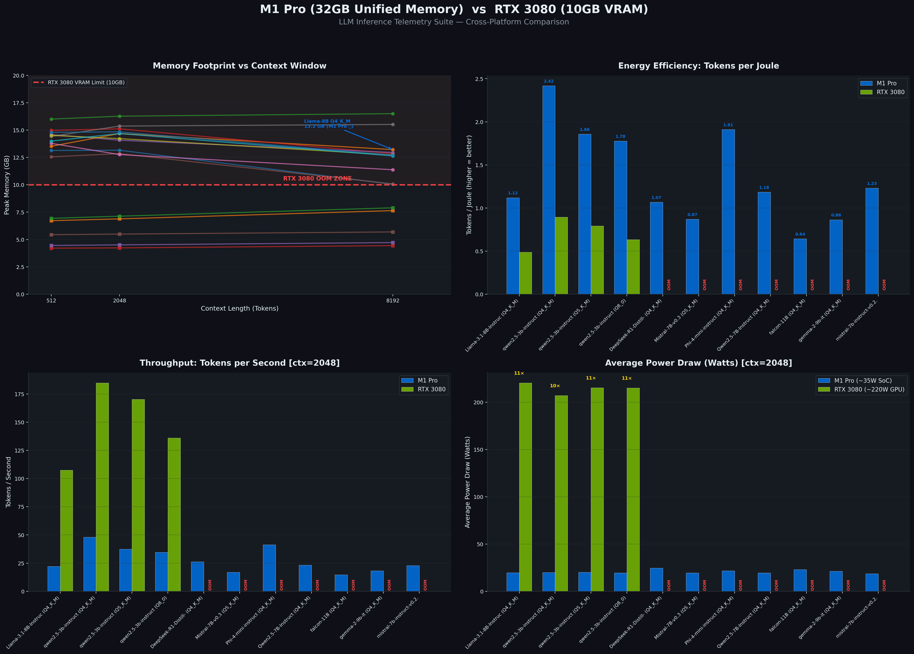

13.7GB workload (Llama-3.1-8B Q8_0 at 8192 ctx): the 3080's 10GB VRAM can't even load it. M1 Pro runs it at 22 t/s at 35W.

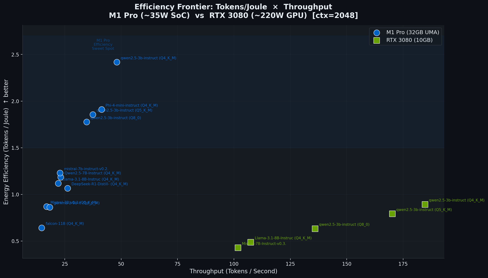

M1 Pro gets 2.42 tokens/joule vs 0.90 on the 3080. The 3080 is faster in raw throughput, but it spends about 2.7 times as much energy per token (2.42 against 0.90 tokens per joule).

> **Power note:** Apple numbers are whole-SoC power from `powermetrics`. NVIDIA numbers are GPU board power from `pynvml`. Not directly comparable, but they're what each vendor's API gives you.

### Hardware ledger

| GPU | Memory | Model | Quant | Peak T/J | Who |
|---|---|---|---|---|---|
| Apple M1 Pro | 32GB UMA | Qwen-2.5-3B | Q5_K_M | 2.40 | @dilbersha |
| Apple M1 Pro | 32GB UMA | Llama-3.1-8B | Q8_0 | 0.63 | @dilbersha |
| NVIDIA RTX 3080 | 10GB VRAM | Qwen-3B | Q4_K_M | 0.90 | @dilbersha |
| Your GPU? | - | - | - | - | Open a PR |

### Running the telemetry suite

```bash
# NVIDIA
./venv/bin/python src/orchestrator.py

# Apple Silicon (needs sudo for power readings)
sudo ./venv/bin/python src/orchestrator.py

# Generate dashboard
./venv/bin/python src/visualizer.py
```

Results land in `results/<hardware-slug>/`. The orchestrator detects your GPU automatically.

## Contributing

If you have different hardware, run the suite and open a PR with your CSV. I'm especially interested in:
- RTX 4090 / 5090: how much does the next gen improve things?
- Apple M4 / M5: does the UMA advantage keep scaling?
- AMD RDNA3+ / MI300X: ROCm efficiency data is basically nonexistent
- Intel Arc: nobody benchmarks these

## Methodology

- 10 runs per config, report mean with 95% CI
- WikiText-2 perplexity alongside throughput (speed means nothing if output is garbage)
- Continuous thermal logging (temperature + clock speed) to catch throttling
- Config hashing for reproducibility: every trial is traceable

## Project structure

```
src/
  orchestrator.py      # main benchmark runner + telemetry
  visualizer.py        # dashboard generation
  experiments/         # optimization experiments
    runner.py          # experiment framework (config hashing, JSON/CSV output)
    exp_real_model.py  # real model experiments on Qwen2.5-0.5B and Phi-2
    exp_e2e_kv_cache.py # end-to-end KV cache generation + logprob replay
    exp_stacking.py    # stacking model (108 combos; modelled, not measured)
    visualize.py       # chart generation
    visualize_real.py  # charts for real model findings
llm_bench/             # CLI (python -m llm_bench)
reports/
  experiments/         # raw experiment data (JSON + CSV)
  charts/              # generated visualizations
results/               # telemetry benchmark results by hardware
```

## License

[MIT](LICENSE)
