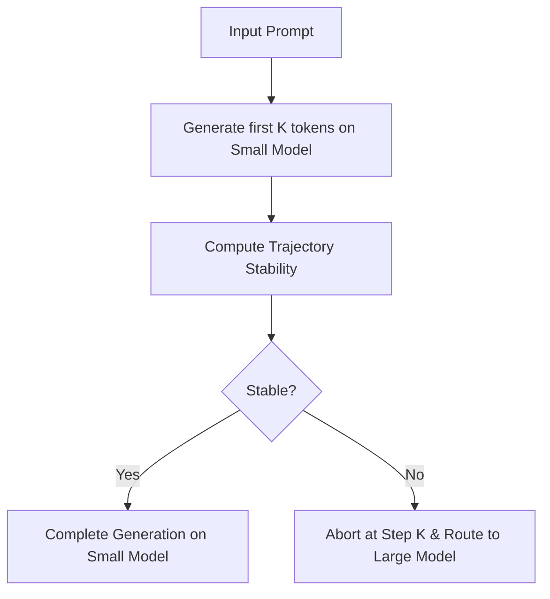

# Technical Report: Speculative Early-Exit Routing (SEER) and Step-by-Step Entropy KV Cache Eviction (SDE-KV)

This report details the design, mathematical formulation, and benchmark status of two LLM inference optimization techniques implemented in this repository.

Read the status notes before the design sections. The original SEER result in section 1 was withdrawn after an audit and replaced by a corrected rerun that reaches a different conclusion. SDE-KV in section 2 is a reimplementation of ideas the 2026 literature already covers. Neither technique is presented as novel.

---

## 1. Speculative Early-Exit Routing (SEER)

### The Problem with Static Routing
State-of-the-art multi-model cascades (such as RouteLLM) predict prompt difficulty statically during the prefill phase before any output token is generated. On very small models (e.g., 0.5B), the prompt embedding space is highly compressed, causing the router to misclassify prompt complexity. The system either over-routes simple queries to the expensive model or fails to route complex queries until the small model has already generated a complete, low-quality response.

### The SEER Design
SEER evaluates the **live trajectory** of the first $K=3$ tokens generated by the small model. Instead of relying on static prefill embeddings, SEER monitors the model's confidence and attention state dynamically.



### Mathematical Formulation
At each step $i \in [1, K]$, we extract:
1. The top prediction probability:
   $$P_{\text{top}}^{(i)} = \max_{v} \text{softmax}(Z^{(i)})_v$$
2. The Shannon entropy of the vocabulary distribution:
   $$H_{\text{vocab}}^{(i)} = -\sum_{v} P_{v}^{(i)} \log P_{v}^{(i)}$$

The trajectory is classified as **stable** if and only if the running average of these metrics over the first $K$ steps satisfies:
$$\frac{1}{K} \sum_{i=1}^K P_{\text{top}}^{(i)} \ge \tau \quad \text{and} \quad \frac{1}{K} \sum_{i=1}^K H_{\text{vocab}}^{(i)} \le \eta$$
Where $\tau = 0.85$ and $\eta = 2.0$ are hand-set thresholds. They were not fitted on a validation set, see the status note below. If unstable, the small model execution is aborted, and the prompt is routed to the large model (`microsoft/phi-2`).

### Results: original claim withdrawn, rerun 2026-09-16

The original claim, that SEER retained 100% of the large model's quality, was produced by an invalid run and is withdrawn. `prompt_routing_20260701_005556.json` recorded 22 trials in which both models emitted the degenerate string `!!!!!!!!!!!!!!!!!!!!` under fp16 non-finite logits, while `quality_retained` compared the routed text against itself and returned 1.0 every time.

The experiment was rewritten: bfloat16 for both models, an explicit finite-logit guard, full generation on both models for every prompt, and the routing rule scored after the fact rather than fused into the generation loop. Results below are from `prompt_routing_20260916_133528.json`.

#### The thresholds are unreachable

$\tau = 0.85$ exceeds the maximum observed value of $\frac{1}{K}\sum P_{\text{top}}$ across all 22 prompts, which is 0.829. No prompt can satisfy the stability condition, so the observed 100% escalation rate is a property of the constants, not of the model or the prompts. Nine of 22 prompts satisfy the entropy condition alone; none satisfy both.

#### The trajectory signal is predictive

| Signal | Pearson r vs small-model quality | AUC | 95% CI |
|---|---|---|---|
| Mean top-prob, first $K=3$ tokens | +0.563 | **0.917** | 0.767 to 1.000 |
| Mean entropy, first $K=3$ tokens | -0.532 | 0.884 | |
| Mean top-prob, full 20 tokens | +0.233 | 0.653 | 0.400 to 0.876 |
| Mean entropy, full 20 tokens | -0.226 | 0.719 | |

Bootstrap over 10,000 resamples, n=22, median split on measured quality.

The premise behind SEER survives: the first few generated tokens carry a usable signal about whether the small model is going to produce something close to the large model's output, and that signal degrades when averaged over the full generation. The implementation and the constants did not survive.

#### The cost model does not support the application

Measured throughput on the RTX 3080 is 45.0 ms/token for Qwen2.5-0.5B and 53.3 ms/token for Phi-2 2.7B, a cost ratio of 0.844 between models 5.4x apart in parameter count. The benchmark loop is bound by eager attention and per-token Python dispatch, not by model compute, so the small model is barely cheaper to run.

At the measured ratio, the best threshold holding mean quality at or above 0.80 returns -0.4% savings. Escalation costs more than it saves because every escalated prompt pays for $K$ small-model tokens on top of the full large-model run.

| Cost ratio | Basis | Best savings at quality >= 0.80 |
|---|---|---|
| 0.844 | measured, this harness | -0.4% |
| 0.19 | projected, parameter ratio | +38.2% |
| 0.10 | projected, batched serving | +43.5% |

Only the first row is a measurement. The other two are projections that combine measured quality with an assumed cost ratio, and they are not results.

#### The difficulty taxonomy does not hold

Mean measured small-model quality by hand-assigned label: hard 0.420, easy 0.349, medium 0.259. The intended ordering does not appear. The labels used to define easy and hard prompts in this experiment, and in the static routing experiment, do not correspond to what the small model can actually do.

#### Limits

22 prompts, one model pair, one GPU, median split for the AUC. Quality is similarity to the large model's greedy output, which measures agreement rather than correctness. The AUC confidence interval is wide and the upper bound touches 1.0. Any claim stronger than "the early-trajectory signal is worth testing at scale" is not supported by this data.

Prior work against which a scaled rerun should be compared: [Semantic Agreement cascades](https://arxiv.org/abs/2509.21837), [Conformal Cascade](https://arxiv.org/abs/2607.25018), and the routing survey at [2603.04445](https://arxiv.org/abs/2603.04445).

---

## 2. Step-by-Step Entropy-guided KV Pruning (SDE-KV)

### Dynamic Budget Allocation
Standard cache eviction policies (H2O, StreamingLLM) apply a fixed, static KV cache budget (e.g., 50% sequence length) throughout the entire generation loop. However, during generation, the model transitions between low-entropy copying phases (where minimal history is required) and high-entropy reasoning phases (which require retrieving context from previous tokens).

SDE-KV dynamically rescales the KV cache budget size at each step $t$ using the newly decoded token's attention entropy as a complexity guide:
$$B_t = \max\left(B_{\text{min}}, \text{int}\left(B_{\text{base}} \times \left(\alpha + (1 - \alpha) \cdot \frac{H(A_t)}{H_{\text{max}}}\right)\right)\right)$$
Where $H(A_t)$ is the average Shannon entropy of the attention distribution for the new token across all layers, $H_{\text{max}} = \log(t)$, and $\alpha = 0.25$ is the minimum budget scale.

```
Low-Entropy Step (high confidence)  --> Shrink budget fraction to save memory
High-Entropy Step (reasoning/coping) --> Expand budget fraction to retain history
```

### The Uniform-Slice Layout
In eager attention implementations (such as standard Hugging Face Transformers models), the causal mask is constructed once for the entire model forward pass, assuming a uniform cache length across all layers. Performing layer-wise pruning (such as PyramidKV) causes shape mismatches:
$$\text{RuntimeError: The size of tensor a (7) must match the size of tensor b (5) at non-singleton dimension 3}$$
To solve this, SDE-KV uses a **uniform-slice layout**:
1. We compute attention variance and entropy across all layers.
2. We select a single, unified set of time indices to retain.
3. We slice the KV cache of all layers identically.

This guarantees that all layers maintain identical sequence lengths, preventing attention shape errors while retaining dynamic pruning capabilities.

---

### Prior art

SDE-KV is not novel as of 2026 and is not presented as such. Decode-time entropy-guided budget allocation is covered by [InfoKV](https://arxiv.org/abs/2606.26875), [ReasonAlloc](https://arxiv.org/abs/2606.11164) and [Moment-KV](https://arxiv.org/abs/2605.29873). Layer-wise dynamic allocation is covered by [LAVa](https://arxiv.org/abs/2509.09754), [ZigZagKV](https://arxiv.org/abs/2412.09036), [CAKE](https://arxiv.org/abs/2503.12491) and [Ada-KV](https://arxiv.org/abs/2407.11550). Rate-distortion allocation is covered by [RDKV](https://arxiv.org/abs/2605.08317) and [RateQuant](https://arxiv.org/abs/2605.06675).

No head-to-head comparison against these methods has been run. The results below compare SDE-KV against H2O, window and SnapKV baselines only, which is enough to show the policy behaves as designed and not enough to claim it is competitive. The uniform-slice layout below is an implementation constraint worth documenting, not a contribution.

## 3. Performance & Quality Evaluation

The benchmark compares SDE-KV (`adaptive`) and head-variance pruning (`snapkv`) against standard H2O and Window baselines under aggressive compression levels.

### 1. Greedy Generation Quality
Using Qwen2.5-0.5B, `snapkv` retains higher semantic similarity to the full-cache baseline than standard `h2o` or `window` policies at tight budgets:

- **Window Eviction**: Collapses quickly because it discards early attention sinks.
- **SnapKV & Adaptive**: Keep quality high by identifying and retaining key attention coordinates dynamically.

### 2. Negative Log-Likelihood (NLL) Distortion
Logprob replay measures how much cache pruning distorts the vocabulary probability distribution compared to the full cache:

- At a 0.9 budget fraction, `snapkv` achieves a negative NLL delta (meaning it matches or slightly improves distribution sharpness compared to baseline).
- SDE-KV (`adaptive`) prevents NLL spikes under heavy compression by dynamically expanding budget slots during high-entropy generation phases.
